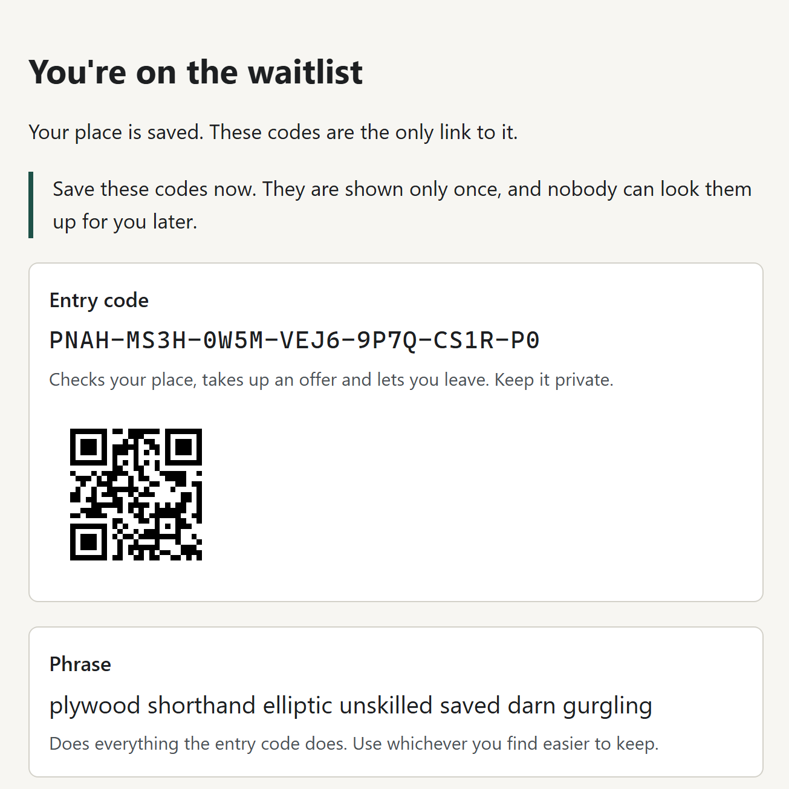

When a small vendor restocks something scarce, a "buy" button rewards whoever is fastest, and bots and stock monitors are faster than people. Evenqueue, a project I'm building in my own time, replaces the race with a waitlist: buyers join over a day or more, and the order is decided afterwards from public randomness. A waitlist has to recognise you when you come back, though, and I didn't want it to know who you are.

So joining is one button with nothing to fill in: no account, name, e-mail, phone number or address. The buyer gets a set of codes, and those codes are their whole relationship with the waitlist. A code they can't keep is as bad as an account they can't sign in to.

Each vendor runs their own copy, on a free Cloudflare Workers account or their own Node server. Evenqueue is in development and not released yet; the source is public at [github.com/naovixen/evenqueue](https://github.com/naovixen/evenqueue).

## Codes that are easy to keep

The entry code is 128 random bits, written as 26 characters of Crockford base 32 in groups of four. Crockford's alphabet leaves out I, L and O, so a code never contains a letter you could read as a digit. The field accepts a code however it arrives:

```ts title="normalise-code.ts"
const lookAlikes: Record<string, string> = { O: "0", I: "1", L: "1" };

export const normaliseCode = (typed: string): string =>
    typed
        .normalize("NFKC") // full-width characters from some keyboards
        .toUpperCase()
        .replace(/[\s\p{Dash}]/gu, "")
        .replace(/[OIL]/g, (letter) => lookAlikes[letter]);
```

Case, spaces, dashes and look-alikes stop mattering, every code still has exactly one spelling, and the field's hint says so.

Each place gets four credentials, with one job each. The entry code does everything. A seven-word phrase does the same for anyone who remembers words better. Its list is adapted from the EFF's large wordlist, without the hyphenated words, which are easy to mistype, or gambling words, which would make a waitlist look like a game of chance. A view key only checks status, so a buyer can hand it to someone helping them. A shorter recovery code is meant for paper.

The codes page offers several ways to keep them, none of which need script: print the page (the print styles leave just the codes), write them down, scan a QR code from a small encoder I wrote, or save the entry code in a password manager.



## Let the password manager remember it

A password manager is the best home for a 26-character secret, so the markup treats the entry code as a password and the waitlist's name as the username:

```html title="codes-page.html"
<form method="post" action="/status">
    <input type="text" name="waitlist" value="Spring restock" autocomplete="username" hidden />
    <input type="password" name="code" value="7K2M-…" autocomplete="current-password" hidden />
    <button type="submit">Check my place now</button>
</form>
```

Pressing "Check my place now" shows the buyer their status and gives the password manager a sign-in to offer to save. The status form's code field carries the same `autocomplete` pair and never blocks paste, as WCAG 2.2's accessible authentication criterion (3.3.8) asks. It turns off spellcheck and autocorrect, and hands back what was typed with any error, so nobody retypes 26 characters to fix one.

## Store only what finds the place

The codes are shown once and never stored. The database keeps values it can look a place up by, and how each is made depends on how hard its code is to guess.

```ts title="lookups.ts"
const toHex = (buffer: ArrayBuffer): string =>
    Array.from(new Uint8Array(buffer), (byte) => byte.toString(16).padStart(2, "0")).join("");

const tagged = (tag: string, code: Uint8Array): Uint8Array =>
    new Uint8Array([...new TextEncoder().encode(`${tag}/v1\0`), ...code]);

// 128 random bits: a plain hash can't be searched back to the code.
export const entryCodeLookup = async (code: Uint8Array): Promise<string> =>
    toHex(await crypto.subtle.digest("SHA-256", tagged("entry-code", code)));

// Fewer bits: key the hash with a secret that is never in the database.
export const recoveryCodeCheck = async (key: CryptoKey, code: Uint8Array): Promise<string> =>
    toHex(await crypto.subtle.sign("HMAC", key, tagged("recovery-code", code)));
```

The entry code and view key have enough bits for a tagged SHA-256. The recovery code (80 bits) and the phrase (about 90) are short enough that someone with a copy of the database could work through guesses against a plain hash, so they're stored as an HMAC under a per-waitlist key kept outside it. Deleting a waitlist deletes its key's salt, so its recovery checks can never be matched again, even in a copy of the database.

## Forms that are safe to send twice

Buyer pages run no JavaScript at all, so every action is a plain form post, and plain forms get sent twice: a double tap, a dropped connection, the back button. The codes are derived from the random nonce in the signed join form, so sending it again shows the same codes and makes no second place.

An audit found the other side: some engines resend a form from history without asking, so on a shared computer the next person could see the last buyer's codes. Now "I've saved my codes" marks the form spent so it shows no codes again, and finishing sends `Clear-Site-Data: "cache"`. Every page is `no-store`, and codes only travel in form bodies, never in an address.

A lost entry code is replaced through the recovery code after a delay, 12 hours by default. Until then the old entry code still works and can cancel the swap, so the person holding it can stop anyone else's attempt.


## The draw, and what it can't stop

Each place gets a fresh public id for every draw, derived from its view key, so buyers can find themselves in a published draw and nobody can link one draw's list to the next. The instance commits to the whole waitlist before the public randomness it names exists; the public verifier that will let anyone check this is a later step.

Holding no identity has a cost. Evenqueue reduces the advantage bots get from speed, and it can't stop a determined bot farm, because everything that would, such as ID, phone or card checks, shuts out the buyers it exists for.

Every buyer page is tested with JavaScript off and checked against WCAG 2.2 AA with axe in Chromium, Firefox and WebKit, but NVDA and VoiceOver passes, and scanning a printed QR code with a real phone, are still to do before the first beta.
