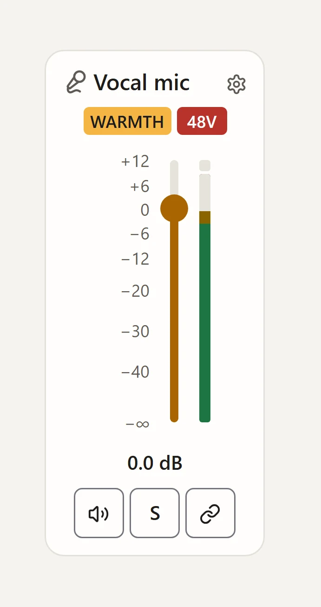
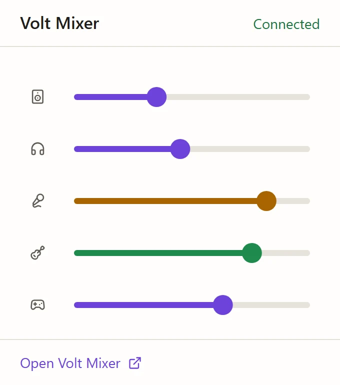

Dragging a single fader in Volt Mixer used to send about 275 reports a second to the audio interface and keep close to a whole CPU core busy. The page let the screen's refresh rate decide how often everything happened, and the machine I benchmark on has a 240 Hz display.

[Volt Mixer](https://naovixen.github.io/volt-mixer/) is my own project. It controls the mixer inside a Universal Audio Volt 4 Gen 2 without UAD Console. It speaks WebHID, which only Chromium browsers ship, so it runs in Edge and Chrome. UA doesn't publish the USB protocol, so I recorded the traffic while Console changed each setting and decoded which bytes moved; the tests re-encode every recording to prove the code still agrees. The [source is on GitHub](https://github.com/naovixen/volt-mixer).


One fader drag touches three different rates: how fast the pointer moves, how often the screen draws, and how much the USB link can take. The fix was to give each one its own pace.

## Measure without the hardware

The bench runs the site in headless Edge with WebHID switched off and a fake Volt installed. The fake answers the start-up requests, sends meter reports 50 times a second and counts every report the page sends back, while a scripted drag moves the pointer every 4 ms, like a 240 Hz mouse. No run can touch a real interface, which matters when the thing under test sets how loud your speakers are.

The baseline showed where the time went. Writes followed the frame rate, every frame recomputed every crosspoint (the gain from each input to each mix) and redrew every view, and the slider handle moved by layout, about 130 layouts a second.

## The device gets a fixed pace

A 240 Hz drag meant 240 writes a second of the same fader's values, more than a full-speed USB link takes in, so writes queued up behind the hand. Now the engine sends at most every 20 ms. Between sends, changes merge so the latest value of each control wins, and while one batch is still being written, the next waits for it. In its smallest form:

```ts title="paced-writer.ts"
export function pacedWriter<T>(intervalMs: number, write: (batch: Map<string, T>) => Promise<void>) {
    let waiting = new Map<string, T>();
    let busy = false;
    let timer: ReturnType<typeof setTimeout> | undefined;
    let lastSent = -Infinity;

    async function send() {
        timer = undefined;
        if (busy || waiting.size === 0) return;
        const batch = waiting;
        waiting = new Map();
        busy = true;
        lastSent = performance.now();
        try {
            await write(batch);
        } finally {
            busy = false;
            if (waiting.size > 0) schedule();
        }
    }

    function schedule() {
        if (busy || timer !== undefined) return;
        timer = setTimeout(send, Math.max(0, lastSent + intervalMs - performance.now()));
    }

    return (control: string, value: T) => {
        waiting.set(control, value);
        schedule();
    };
}
```

The `Map` does the merging: pointer moves between ticks overwrite one entry, and only the newest value goes out. Waiting for the previous write means the queue never falls behind your hand. The engine also recomputes only the crosspoints of the channels a change touched; a solo, a link or a new mix still compares them all.

## The screen draws only what changed

Views draw once a frame, and each change names the parts of the state it touched (these channels, the outputs, the inputs) so each view redraws only its own. When in doubt, a change names more, because an extra topic costs a little time and a missing one leaves a stale view. The same goes for single attributes: writing `aria-valuenow` with the value it already has still costs a style pass and a screen reader update, so the slider compares before it writes.

The meters drew on every screen refresh, up to 240 a second, though the Volt only reports 50. Now the engine passes on at most 30 frames a second, each holding the highest peak since the last, and a meter is redrawn only when it moves a whole pixel. The held peak falls by elapsed time, so it drops at the same speed on any screen, and a hidden page reads no meter reports at all.



## The pointer moves the handle without layout

The slider's handle and fill move with `translate` and `scale`, measured against the control itself as a size container, so `100cqi` is its length. Script sets one custom property from 0 to 1 and CSS does the rest:

```css title="slider.css"
.slider-control {
    --position: 0; /* 0 to 1, set by script */
    position: relative;
    container-type: size;
    block-size: 1.5rem;
}

.slider-fill {
    position: absolute;
    inset: 0;
    transform-origin: left;
    scale: var(--position) 1;
}

.slider-thumb {
    position: absolute;
    inline-size: 1.5rem;
    aspect-ratio: 1;
    translate: calc(var(--position) * (100cqi - 1.5rem)) 0;
}
```

A drag frame then needs no layout except for the readout's text. The cost of size containment is that the control can't size itself from its contents, so each needs an explicit size: a block size here, a grid track for vertical faders. The meters' covers shrink by transform too, and keep `will-change: transform`, because without it painting doubled, from 12 to 22 ms a second.

## What it bought

On the website, the page's own work at idle halved, from 51 to 29 ms a second, and a drag sends 72 writes a second instead of about 275. A trace of a drag shows three style changes a frame: the slider's position, its readout and the meter covers. What's left is the browser drawing every refresh while the handle moves, which it should.

The desktop app gained more. The engine has no DOM, so it moved into Electron's main process with node-hid, and the app draws in software, since a mixer page needs no GPU. In the tray no page runs at all: four processes instead of five, and 82 MB of private bytes instead of 245. A drag with the window open went from 11% of the machine's CPU to about 4%.



Headless CPU readings moved by about a percent of the machine from run to run, enough to swamp a small win. The page's own work and the count of writes held steady, so those are the columns I judged each change by.
