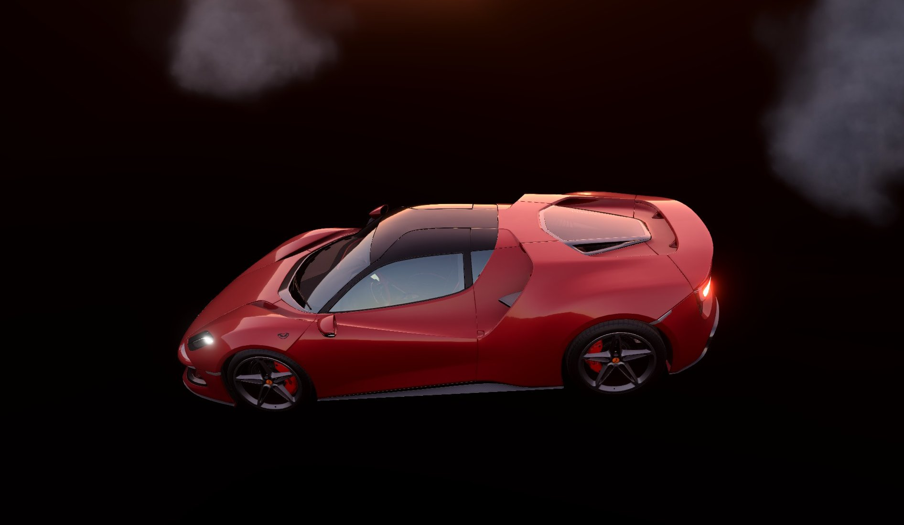
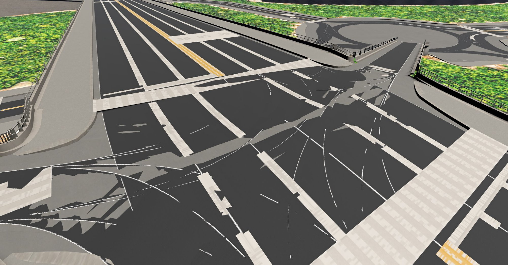
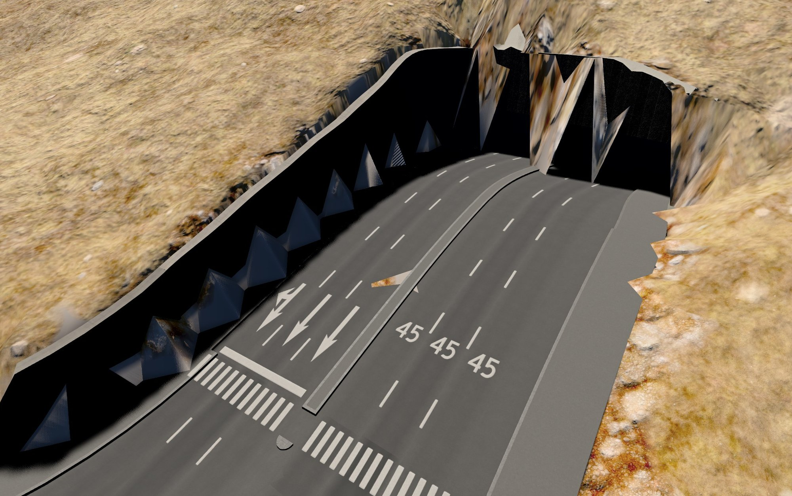
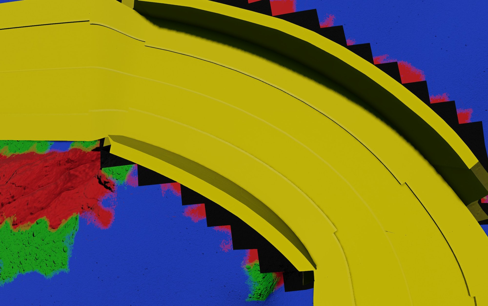
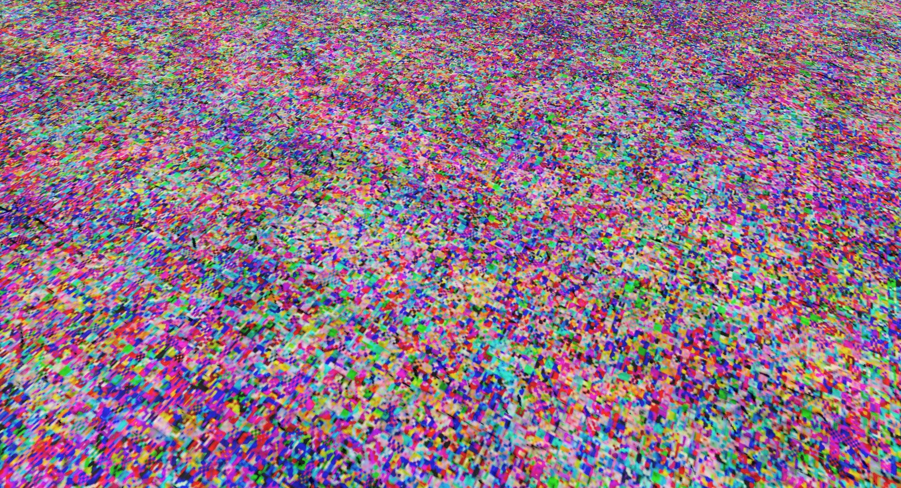
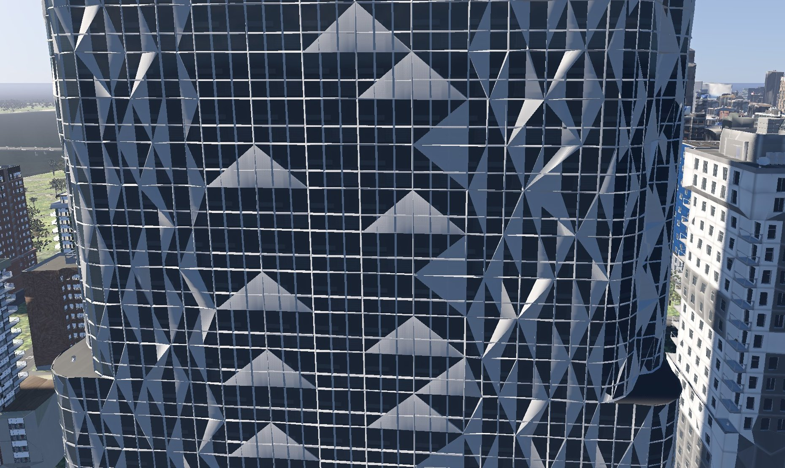

<Facts
    items={[
        { label: "my role", value: "Ripper, app and level builder, with Claude Code alongside" },
        { label: "timeline", value: "2026" },
        { label: "built on", value: "A fork of Taipei Native's Carto" },
    ]}
/>

Someone in the Cities: Skylines II community had already built Leonida, the setting of Grand Theft Auto VI, and I wanted a glimpse of it from behind the wheel in BeamNG.drive. That took two halves. The ripper, my fork of Taipei Native's open-source [Carto](https://github.com/taipei-native/Carto) mod, runs inside the game and writes out the whole city. cs2beamng, a desktop app and command line, builds what the ripper writes into a BeamNG level. Both are [on GitHub](https://github.com/naovixen/csii-world-bundle).

## The problem

Cities: Skylines II holds 1.2 million placed objects whose meshes exist only inside the running game. It assembles roads from parts as it draws them, hides the ground at tunnel mouths with a rendering trick, and tints buildings by its own rules. BeamNG wants a level: a heightfield, static meshes, materials in its own format, and every mesh the level places held on the graphics card for the whole session.

So the city had to look like the game, drive like a BeamNG level and fit on an 8 GB card. Ripped meshes and textures come from the player's own copy of the game, so the tool is for personal use and never publishes them.

## Where it started

The first attempt, CS2toBeamNG, was a quick trial built on what vanilla Carto already exports. It read the real Leonida export, a 14.3 km map with 8,897 building footprints and 7,480 roads, decoded the game's heightmap (528.20 m under a building that reported 528.19 m), and extruded each footprint into a grey box with a height guessed from its zone.

It was drivable, and it showed me what was missing. Footprints and centrelines are enough for a map, but to recognise Leonida from behind the wheel I needed real buildings with their textures, roads with kerbs, and tunnels where the trial had left gaps. That meant reading the game's own meshes, materials and positions from inside the game.

## My approach

I split the project at a file format. The ripper writes a versioned "CS2 World Bundle", documented by a schema, fifteen JSON Schemas, a minimal example and a validator, so a reader needs no copy of the game and none of the mod's code. It's the same idea as building a front end against a well-documented API. Two readers sit beside the mod: cs2beamng, and a Blender importer I used to check each rip by eye before BeamNG ever saw it.

Where the game's behaviour wasn't documented, I learnt to read it from the game's decompiled code and port the rule. Most of the challenges below began with a guess of my own that didn't hold.

## Challenges

### Getting the coordinates right

Nothing mapped 1:1 between the games. In early testing I spawned underneath the map, and the terrain threw artifacts up into the sky or out sideways. The trial even stood the city on its edge: the mesh files declared Y as up, BeamNG uses Z, so 14 km of city turned to vertical.



The ripper brought subtler ones. The bundle keeps the game's frame, x east, y up and z north, which is left-handed. BeamNG uses x east, y north and z up, which is right-handed, so every position swaps two axes and every mesh is mirrored. BeamNG's clock counts from noon, too, so my first level loaded at 01:20 instead of 12:51, in the dark.

Rotation was the bug I learnt most from. BeamNG reads an object's nine rotation values as its three axes in turn, and I'd written the matrix row by row, which is the inverse rotation. On a north-south street grid that's invisible, so whole districts looked right while the diagonal ones were scrambled. The street lights gave it away: a light has no mesh to hide the mistake, only a direction, and ours pointed the wrong way.

```python title="frame.py"
import numpy as np


def to_beamng(point: np.ndarray) -> np.ndarray:
    """The bundle is x east, y up, z north; BeamNG is x east, y north, z up."""
    x, y, z = point
    return np.array([x, z, y])


def rotation_values(rotation: np.ndarray) -> list[float]:
    """BeamNG reads nine values as the object's x, y and z axes: the matrix's columns."""
    return rotation.T.flatten().tolist()  # flattening row by row writes the inverse
```

I settled it without BeamNG at all. The game builds a building facing its street, so a building and its nearest lane should line up: under the reading I'd shipped they were a median 14.24° apart, and under the correct one 0.01°. On the rebuilt level, 16,768 objects near a lane sit a median 0.10° off their street.

### Rebuilding roads from their parts

Cities: Skylines II has no mesh for a stretch of road. Each road type names a cross-section of parts, such as carriageway, kerb and pavement, and the game bends every part along curves that trace the road's edges. A first spike did the same on the CPU for one road and its two junction flares: exactly 16.00 m wide, with 0.0000 m seams between the pieces.

Junctions were the hard part. Across the city, 1,607 of 1,817 road junctions had every flare stopping more than a metre short of the middle, leaving a hole. The game fills it in a shader that decides which vertices follow which curve, and those shaders ship compiled inside the game's asset bundles, out of the decompiler's reach. So I worked backwards from the code around them: what the shader is fed, and what a finished junction looks like.

Five explanations reasoned from the code fell apart once I measured them, and a stand-in fill I'd built was deleted when I ported the game's own mesh generation instead. The breakthrough came from a screenshot of the game: by colour ratio, the inside of a junction matched the road surface (red to blue, 1.635) and not the dirt beneath it (about 1.87), so it had to be road geometry. A dump of the parts at eight such junctions turned up a part with zero width whose mesh has real width. My port had collapsed it into a line, and the fix was one line.

BeamNG brought trouble of its own: in one load every big junction broke into shards, from road tiles with more than 65,535 vertices. Tiles now split at 60,000.



Across 5,872 junction strips, the bare edge left is at most 0.93 m, and under 0.36 m for 99% of them. That's good enough to drive.

### Cutting tunnels into the terrain

Tunnels gave the most visibly wrong results. Mouths jutted out of hillsides, cuts left teeth along the walls, and some left holes in the map with sky showing through.

The game never carves its heightmap. Every frame, it hides the ground inside an invisible volume swept along each tunnel mouth and sunken road. BeamNG's terrain can only punch out whole squares, so a per-pixel trick had to become real geometry.

For a while I approximated it, and each fix closed one gap and opened another: curtains across tunnel bores, pale bands along every wall, 12 m spikes behind them. One rewrite made the next load worse, with walled-off tunnel mouths and moats beside sunken roads, and I reverted it. So I paused, looked more closely at how the game itself does it, and replicated that.



The game's terrain code states the rule plainly: draw a terrain pixel unless it lies inside one of those volumes. That question has an exact answer on a triangle, so the cut now subtracts each volume from the terrain triangles it touches, with no sampling, snapping or lifting. Checked against the game's rule, it agrees on 99.983% of sample points at a trench and 100% at a tunnel mouth. Open-sky gaps at that mouth fell from 65 to 3, and the old method turned out to have punched 8,132 squares with nothing under them.

One artefact remains: a flat grey band beside every cut. To trace it, we gave every terrain material a loud flat colour and reloaded, and the grey came back red, the colour of material zero. BeamNG stores a hole in the same byte as the ground's material, so a punched square forgets what it was and its neighbours blend in material zero. No fix I've found stays true to the game, so the band is documented and left alone.



### Recreating the world's colours

Colour went wrong more often than anything else, and loudly: pure black, purple, green. Nearly every time, two programs disagreed about a convention.



- The trial's first level was black, because a BeamNG level with no sun has no light.
- Close up, the ground dissolved into purple and green noise. The textures were fine: BeamNG keeps one global, case-insensitive list of terrain materials, and an older test level's grass was shadowing the new one. Every material name now carries its level's name.
- The ground then looked nearly black. The game's grass is very dark, about 0.06 in linear terms, where BeamNG expects nearer 0.2, so I calibrated a gain on grass.
- In the Blender check, each road came out a different colour, and later every car park and path went black. The game packs normal maps into two channels, and read as ordinary colour they turn a surface away from the sun. The ripper rebuilds them now.
- Some buildings rendered black. Both games tint a building through a mask, but BeamNG takes the amount of tint from the mask's alpha. I'd exported it fully opaque, so wherever the game meant "don't tint", BeamNG multiplied by zero: 61% of every tintable surface. Alpha now comes from the mask's own channels, which matches the game to within one 8-bit step.

Two early "colour" bugs were in Blender, my checking tool: its default view transform turned the grass brown, and its alpha handling drew the ground at a tenth of its brightness.

### Getting the frame rate playable

Once the buildings and trees went in, the level ran at 2 frames a second. Making it playable took a lot of measuring, and most causes weren't where they looked.

The 2 fps was BeamNG building billboard stand-ins at runtime for every object shape in the level: 4,245 of 4,245, where its own West Coast USA map uses 82 of 2,608. Limiting them to 153 shapes, 3.6% of the total, ended the stall.

Collision came next. The bundle filed every plant as a tree, so bushes and 314,222 patches of long grass were as solid as trunks. The game's own data says which plants are trees, and splitting on it took collision off exactly 376,187 plants. An airport's collision had collapsed into a box 1,344 m across, so driving onto it put the car inside a solid, invisible block. Anything past 20 m now keeps real collision.

Memory was the next limit. At one point 5,071 MiB of files became 14.2 GB of video memory on an 8 GB card, and the level ran at a flat 8 fps wherever I pointed the camera. Hiding the forest didn't move it, so the limit was how much the level held in memory. Distant trees became flat billboards, taking the forest from 9.2 million triangles to 1.4 million at 8 km, and I trimmed textures, foliage and props.

The last step thinned meshes where the surface measurably stays put. Raising the tolerance from 3 cm to 8 cm made the frame rate lovely, and my screenshots showed the facades torn open. Thinning one material at a time had let a wall and its glass stop sharing vertices, so seams opened while every vertex barely moved. I went back to 3 cm, with a 25 cm cap on the worst point.



Memory on the card fell from 2,990 MiB to 2,277, and the city ran at 40 to 60 fps, dipping to about 20 when panning into a dense area.

### Building a level from scratch, and explaining it

cs2beamng builds a level from nothing but the bundle: terrain, water, sky, roads, buildings and materials, with the meshes precompiled by BeamNG's own tool and the result validated at the end. A full-city build fell from 100 minutes to 19. Every long step runs in a worker process, and the interface does none of the work itself: it shows progress, the time remaining and a Cancel button.

The harder part was making all that clear to someone who'd never seen the repo. Installing it once meant cloning the repo and installing Python packages. Now it's a Windows app you unzip and run, and it can install the ripper mod into the game for you.

The settings were where I learnt most. The first screen showed nine of 79 settings and hid the rest, and the presets seemed to do nothing: each changed 12 to 20 settings, all hidden, so pressing one moved a highlight and nothing else. I rebuilt it around a sidebar and search, with one plain sentence under each control and a badge counting what you've moved off the preset. A preset now says what it gives you and which one fits your machine.


The cost meter predicts the video memory a level will need before a long build, warns rather than blocks, and says how each figure was worked out. On a level it had never been fitted to, it predicted 3,934 MiB against 3,942 measured.


## What it achieved

The ripper takes a whole city, 1.28 million objects in its latest rip, in about 28 minutes. cs2beamng ships as a Windows app, and Leonida runs at 40 to 60 frames a second on an 8 GB card, with its roads, tunnels and colours checked against the game's own rules.

BeamNG's overlay now reads 20.7 ms of CPU against 18.7 ms of GPU a frame, so draw calls are the limit. The level ships 5,546 materials against vanilla BeamNG's 586, and combining them is the next lever.

<Callout label="lesson learnt" title="Read how the original works before writing a workaround">
    Junctions cost me five wrong explanations, and tunnels seven guesses, before I read how the game actually builds
    them. Each guess fixed what I was looking at and broke something I wasn't. When one engine has to imitate another, I
    now find the original's rule first, port it, and measure against it.
</Callout>
